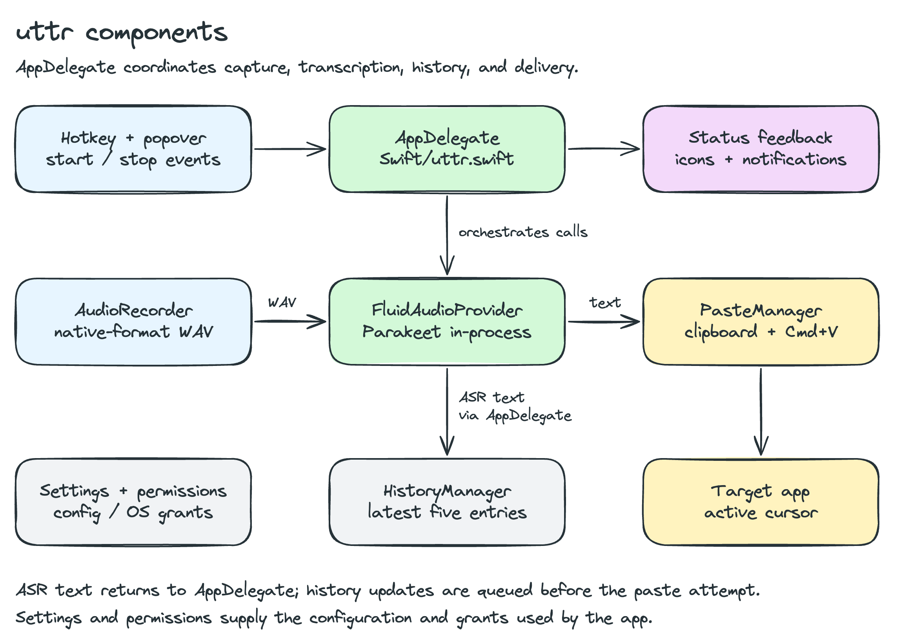
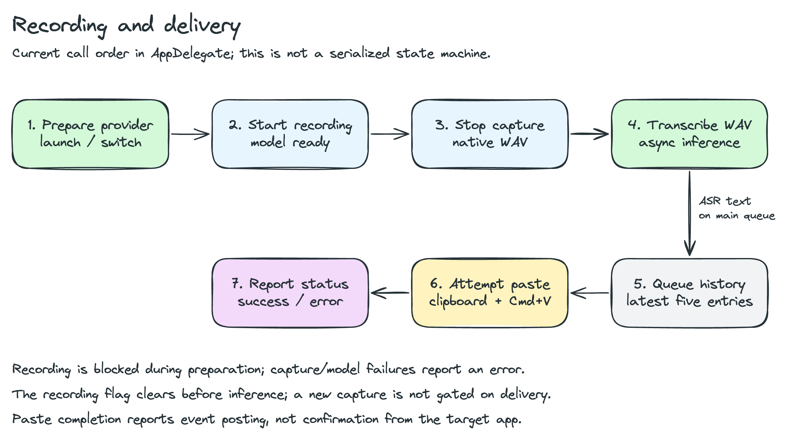

# Architecture

uttr is a Swift macOS menu-bar app. FluidAudio runs Parakeet in-process on Apple
Silicon. Model preparation can download files; transcription itself runs locally.

## Recording and Delivery

`AppDelegate` in `Swift/uttr.swift` creates the components and coordinates the
recording-to-paste flow:

1. Launch or a provider change calls `prepare()` to download/load the selected
   model. Recording is blocked until `isProviderReady` is true.
2. The registered hotkey or popover starts `AudioRecorder`. A second invocation
   stops capture and hands back a temporary WAV at the input's native format.
3. An asynchronous task calls `FluidAudioProvider.transcribe(audioFileURL:)`.
4. On the main actor, AppDelegate queues a history update and calls `PasteManager`.
   Paste uses the clipboard and simulated `Cmd+V` events; success/error feedback
   updates the menu-bar icon and notifications.

The recording flag is cleared before transcription starts. The current app does
not serialize the entire capture/transcription/paste flow or keep its asynchronous
tasks in a separate session owner. Provider switches tear down and replace the
provider in an asynchronous task. Changes to these lifetimes need explicit review
of busy input, provider switching, delayed callbacks, and quit behavior.

## Components

| File under `Swift/` | Responsibility |
|--------------------|----------------|
| `uttr.swift` | App lifecycle, component wiring, recording/transcription orchestration, windows |
| `AudioRecorder.swift` | AVAudioEngine capture to a native-format temporary WAV; interruption reporting |
| `AudioDeviceManager.swift` | Core Audio input enumeration and UID → runtime device ID lookup |
| `HotkeyManager.swift` | Registered global hotkey via Carbon |
| `PasteManager.swift` | Clipboard write, simulated paste, delayed restoration of previous plain text |
| `SettingsManager.swift` | YAML persistence, provider/device/hotkey changes |
| `PermissionManager.swift` | Microphone and Accessibility checks, onboarding, permission refresh |
| `HistoryManager.swift` | Latest five transcriptions, JSON persistence, copy/clear APIs |
| `MenuBarPopoverView.swift` | Recording controls and callbacks through `PopoverViewModel` |
| `SettingsWindowView.swift`, `SettingsTabView.swift`, `HomeTabView.swift` | Settings, permissions, and history UI |
| `MenuBarIconManager.swift`, `NotificationManager.swift` | Status feedback |
| `Transcription/TranscriptionProvider.swift` | Provider protocol and factory |
| `Transcription/FluidAudioProvider.swift` | Parakeet v2/v3 preparation, inference, teardown |
| `Logger.swift` | Shared locked writer for component logs |

## Input Device Selection

Settings persist a Core Audio **device UID**, which `AudioDeviceManager` translates
to a runtime device ID for each recording. A missing pinned device falls back to
the system default. A device that stops mid-recording causes the capture to be
discarded and an interruption callback to report the error.

`AudioRecorder` builds a fresh engine per recording and sets the input node's HAL
device through `AUAudioUnit.setDeviceID(_:)`. Input and output share an I/O unit.
For a pinned capture-only device whose output format is empty, the recorder skips
the mixer connection and records from the input tap. Devices with a valid output
format keep the mixer connection. The WAV preserves the input's native format;
FluidAudio handles the file for inference.

## Provider and Settings

The default is `fluidaudio.parakeet.v3` (multilingual); v2 is English-only. Xcode
resolves FluidAudio and Yams through Swift Package Manager. See
[Configuration](configuration.md) for the YAML schema and model-selection behavior.

`prepare()` calls `AsrModels.downloadAndLoad` and creates the `AsrManager`; the first
download is approximately 600 MB. FluidAudio manages its model cache. `transcribe()`
requires a prepared manager, and `teardown()` calls its cleanup method.

## Local Storage

| Data | Current location and behavior |
|------|-------------------------------|
| Settings | `~/Library/Application Support/uttr/settings.yaml`; shared by Debug and Release |
| History | User Documents directory + `History/transcription_history.json`; latest five entries; shared by both builds |
| Release logs | `~/Library/Logs/uttr/transcriptions.log` |
| Debug logs | `~/Library/Logs/uttr Debug/transcriptions.log` |
| Recordings | macOS temporary directory; filenames include a recording timestamp |

AppDelegate requests a history update before attempting paste. HistoryManager
queues the list update and JSON write on the main queue; persistence is not a
prerequisite for posting paste events. History can recover a failed insertion. Its current writes are not coordinated across simultaneous app
instances. Completed WAV files are not explicitly deleted after transcription;
discarded interrupted captures are removed by the recorder.

Debug and Release use separate bundle IDs and permission grants. Their shared
settings/history and separate log directories are described in
[Development](development.md). The [Releasing Guide](releasing.md) covers packaging
and the separate Homebrew tap.
