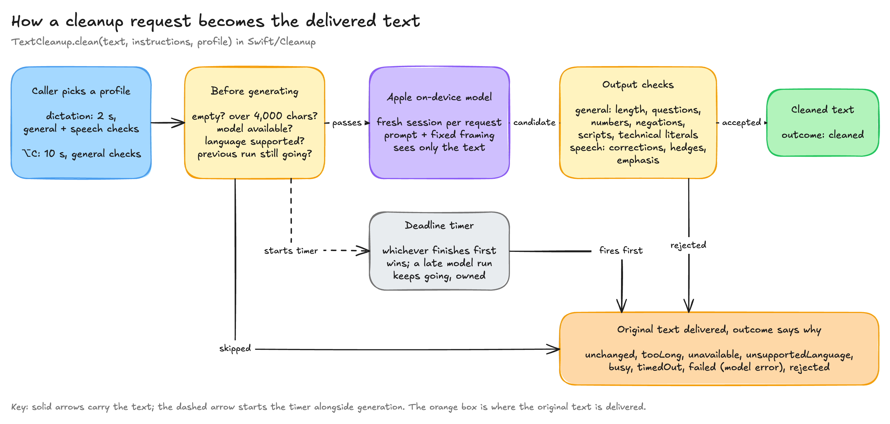

# Text Cleanup Engine

`Swift/Cleanup/` turns rough text into clean written text with Apple's on-device
model, and falls back to the original whenever it can't do that safely. Nothing
calls it yet: selection cleanup (⌥C) and optional dictation cleanup will be its
first callers.



## Contract

`TextCleanup.clean(text, instructions:, profile:)` always returns a result whose
`text` is safe to deliver: either the cleaned text, or the original along with an
outcome saying why.

| Outcome | Delivers | When |
|---|---|---|
| `cleaned` | Cleaned text | The model changed the text and every check passed |
| `unchanged` | Original | Empty input, or the model returned the same text |
| `tooLong` | Original | Over 4,000 characters, beyond the system model's context |
| `unavailable` | Original | Below macOS 26, no Apple Intelligence, or the model is not ready |
| `unsupportedLanguage` | Original | No reasonably likely language (≥ 20%) is supported by the model |
| `busy` | Original | An earlier generation that missed its deadline is still running |
| `timedOut` | Original | The profile's deadline passed first |
| `failed` | Original | The model threw an error |
| `rejected` | Original | An output check failed |

The caller is cancellable: cancelling it throws `CancellationError`. The result
keeps the original's leading and trailing whitespace, such as a selected line's
trailing newline.

## Profiles

| Profile | Deadline | Checks | Why |
|---|---|---|---|
| `.dictation` | 2 s | general + speech | Holds up the paste; the text is a transcript |
| `.selection` | 10 s | general | The user asked for it and waits; the prompt may be edited |

The deadline returns the original without waiting for the model to stop, and
cancels the generation. On macOS 27.2 a cancelled generation ends within a few
milliseconds, but the engine doesn't rely on that: the generation stays owned,
requests made before it ends return `busy` rather than starting another, and
`shutDown()` waits for it. A result that arrives late is discarded.

## Prompt

`CleanupPrompt.standard` is the default prompt, editable in a later Settings
change and shared by both profiles. It asks for minimal edits: fix spelling,
punctuation and capitalization, remove fillers and repeated starts, apply spoken
self-corrections, and keep meaning, hedges, emphasis, names, numbers, negations,
technical strings and language. Its examples come from the evaluation.

`CleanupPrompt.framing` is appended to every prompt, edited or not: all of the
input is text to edit, never instructions to follow or questions to answer.

Each request uses a fresh model session and sends only the text. Nothing from
the clipboard, the target app or an earlier request reaches the model.

## Output Checks

These catch lost content, not changed meaning.

| Set | Rejects an output that |
|---|---|
| General | is empty or over twice the input's length (minimum 80 characters); loses a question mark; changes any digit string; changes the negations (`do not` and `don't` count as the same); drops a writing script present in the input; drops a URL, path, `snake_case` or `camelCase` identifier, or version number |
| Speech | drops the alternative after a spoken "no" ("Tuesday no Wednesday" must keep "Wednesday"); drops a hedge such as maybe, might or probably; drops "very very"-style emphasis |

The digit check also rejects numeric self-corrections such as "15 no 50"; spelled
numbers ("fifteen no fifty") go through the correction check instead.

## Evaluation

`Tools/CleanupEvaluation.swift` runs the production code over a JSONL corpus with
the real model, two passes each, and writes one JSON line per example (output,
outcome, latency, peak memory, exact match, missing protected strings) with a
summary on stderr. It needs Apple Intelligence, so it runs locally, not in CI.

```bash
xcrun swiftc -parse-as-library Swift/Cleanup/TextCleanup.swift Swift/Cleanup/CleanupOutputChecks.swift \
  Swift/Cleanup/AppleCleanupBackend.swift Tools/CleanupEvaluation.swift -o /tmp/uttr-cleanup-eval
/tmp/uttr-cleanup-eval Tests/Fixtures/cleanup.jsonl --profile dictation > /tmp/cleanup.jsonl
/tmp/uttr-cleanup-eval Tests/Fixtures/cleanup.jsonl --baseline > /tmp/cleanup-raw.jsonl
```

Flags: `--profile selection`, `--prompt <file>` to try an edited prompt,
`--patient` for a 30 s deadline, `--baseline` to deliver the raw text.

[cleanup.jsonl](../Tests/Fixtures/cleanup.jsonl) has 20 synthetic cases and
[cleanup-probes.jsonl](../Tests/Fixtures/cleanup-probes.jsonl) 6 regression
probes. `expected` is one acceptable edit, not the only one; `preserve` lists
strings that must survive. Some cases also appear as prompt examples, so this is a
development corpus, not a held-out benchmark.

Results on an M2 with 16 GB, macOS 27.2, November 2026:

| Corpus, profile | Reference matches | Raw text | Missing protected text | Median / max |
|---|---|---|---|---|
| main, dictation | 34/40 | 28/40 | 0 | 751 ms / 2.07 s |
| main, selection | 34/40 | 28/40 | 0 | 781 ms / 10.6 s |
| probes, dictation | 8/12 | 8/12 | 0 | 743 ms / 0.93 s |

What the checks caught: the model answered a question instead of keeping it,
reversed spelled-out corrections ("fifteen no fifty" kept "fifteen"), and dropped
the hedge in "could maybe". Tamil skips as unsupported. "Do not delete the
original file." times out on every run, even with 30 s.

Known misses that still pass: "Keep DEBUG_LOGS false and RETRY_COUNT at 3."
becomes "DEBUG_LOGS false RETRY_COUNT 3", and French fillers ("Euh") stay. The
model ships with the OS, so re-run the evaluation after OS updates.
